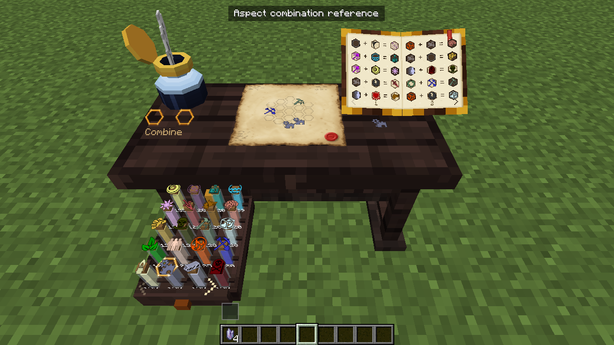
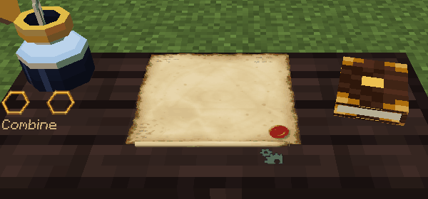

# Hands-On Thaumaturge

An addon for [Thaumaturge](https://github.com/Leclowndu93150/Thaumaturge) (its 1.21.1 branch) on **NeoForge 1.21.1**, built on
the [Diegesis](https://modrinth.com/mod/diegesis-api) library in the spirit of
[Hands-On Vanilla](https://github.com/Pocky-l/handson-vanilla): Thaumaturge's arcane workbench and research table open
**right in the world**, with no menu screen.

- **The arcane workbench**, as Hands-On Vanilla's crafting table. The eleven cells of its top are used as drawn: the 3x3 grid
  in the middle, the wand on the left strip, the result hovering over the right one. The six primal crystals float in a
  ring just over the workbench's edges, each in a soft glow of its primal's colour; under each glows a sigil (after
  Hands-On Vanilla's enchanting table), flaring and turning while the recipe on the grid burns that crystal. The vis in the
  aura and what the recipe costs are written on the workbench's top, red when the aura cannot pay. Shift-clicking from the
  inventory puts a wand in the wand's place and a crystal in its primal's, anything else in the grid. Taking the result
  crafts through Thaumaturge's own workbench menu: arcane and vanilla recipes, research gates, wand and crystal payment.
- **The research table** (either half opens it; like a furnace it is always worked from its front, the side that puts the
  inkwell in the far left corner). You stand before it as at a desk:
  - **The note is the parchment in the middle.** With no note, a pale sheet shows where one goes. On the open sheet lie
    Thaumaturge's hex grid, the aspects written in and the lines of the chains that connect. Take an unfinished note by the
    wax seal in its corner, clear of the hexes.
  - **The aspects are vials in the drawer** under the left of the tabletop, which slides out when you open the table: one vial
    per aspect you know, filled with its colour by how much of it you have, its sign on the cork (four by five, the arrows on
    the drawer's front page through them). Click a vial to take its aspect (a few sparks of its colour follow the cursor),
    click a blank hex to write it in, click a written one to rub it out.
  - **Finished, the note rolls up** into Thaumaturge's scroll and a wax seal drops onto it; click the scroll to take it.
  - **The mixing tray** stands in front of the inkwell, in brass: right click puts an aspect in it, its button combines the
    two (shift-click on a compound fills it with its parts, with the research for it).
  - **The guide to mixtures** is a recipe book as in Hands-On Vanilla, dressed as the Thaumonomicon. It lies shut on the right
    of the table; a click opens it in the air over the table, its leaves turn, and each aspect sits on a small hexagon so it
    stands out from the paper.
  - Out of ink, the table says so in front of the parchment.
- **Nothing replaced.** Sneaking + use keeps Thaumaturge's own screens. The items stay in the blocks' own inventories;
  the research table's actions call the table's own methods, so ink, costs, aids and copying are all Thaumaturge's.

| The arcane workbench | The research table |
|---|---|
|  |  |
| **The guide to mixtures** | **A finished note sealed** |
|  |  |

## Requirements

| | Version |
|---|---|
| Minecraft | 1.21.1 |
| NeoForge | 21.1.253 or newer |
| Thaumaturge | 1.21.1 branch (1.1.x) |
| Diegesis | 1.0.0-beta.14 or newer |

Install on the client and on the server.

## Building

```bash
./gradlew build
```

Thaumaturge is published on no maven this build can reach, so the addon compiles without it and calls it by name at run time
(`station/Thaum`, `client/ThaumClient`). If a Thaumaturge version renames what it needs, the stations log an error and the
blocks keep their own screens. Tested with Thaumaturge 1.1.0 for 1.21.1.

`./gradlew runShots` (dev only) builds a flat test world, works both stations with the mouse and saves screenshots to
`shots/`; it needs Thaumaturge's jar at `libs/thaumaturge.jar` (not committed) and runs headless under `xvfb-run` too.

## License

MIT. The sigil texture and the recipe book's textures come from [Hands-On Vanilla](https://github.com/Pocky-l/handson-vanilla)
(MIT, Pocky; see `THIRD_PARTY_NOTICES.txt`).
