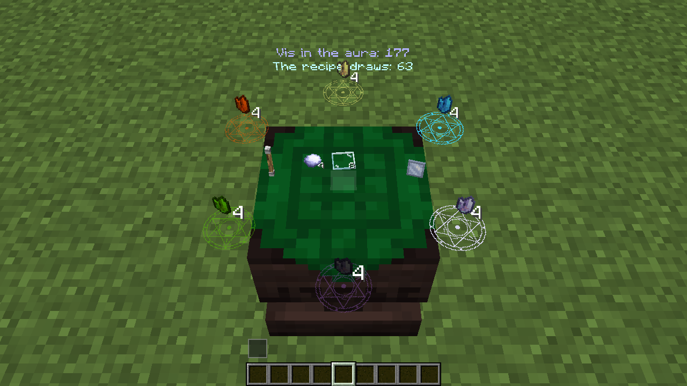
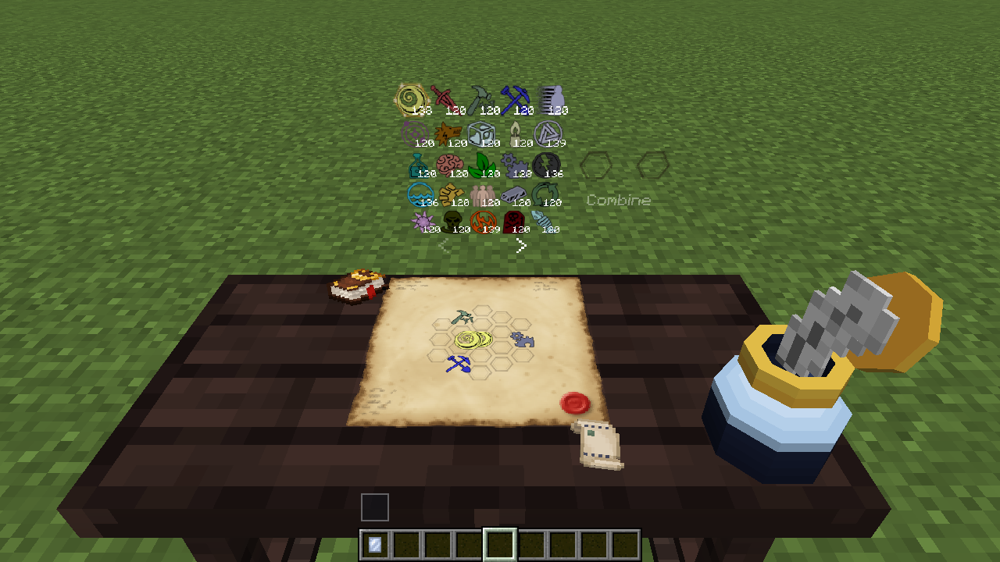

# Hands-On Thaumaturge

An addon for [Thaumaturge](https://github.com/Leclowndu93150/Thaumaturge) (its 1.21.1 branch) on **NeoForge 1.21.1**, built on
the [Diegesis](https://modrinth.com/mod/diegesis-api) library in the spirit of
[Hands-On Vanilla](https://github.com/Pocky-l/handson-vanilla): Thaumaturge's arcane workbench and research table open
**right in the world**, with no menu screen.

- **The arcane workbench**, as Hands-On Vanilla's crafting table. The eleven cells of its top are used as drawn: the 3x3 grid
  in the middle, the wand on the left strip, the result hovering over the right one. The six primal crystals float in a
  ring round the table, clear of the grid, in the screen's places; under each glows a sigil (after Hands-On Vanilla's
  enchanting table) in its primal's colour, flaring and turning while the recipe on the grid burns that crystal. Over the
  far edge stands the vis in the aura and what the recipe costs, red when the aura cannot pay it. Taking the result crafts
  through Thaumaturge's own workbench menu: arcane and vanilla recipes, research gates, wand and crystal payment.
- **The research table** (either half opens it; the sheet lies in the middle of the whole table). The scribing tools go in where Thaumaturge draws its own inkwell and quill, the note lies in front. With
  a note in, its puzzle lies open on the table on parchment: Thaumaturge's hex grid, the aspects written in, the lines of the
  chains that connect. The aspects you know hang over the far edge as a panel of icons (five by five, paged as in the screen:
  the wheel or the arrows). Click one to take it up, click a blank hex to write it in, click a written one to rub it out.
  Right click puts an aspect into the mixing tray beside the panel, whose button combines the two (shift-click on a compound
  fills the tray with its parts, with the research for it); the copy button appears for a finished note when you can copy
  it. The book on the table opens the guide to mixtures in the air beside it, as Hands-On Vanilla's crafting table shows
  its recipe book.
- **Nothing replaced.** Sneaking + use keeps Thaumaturge's own screens. The items stay in the blocks' own inventories;
  the research table's actions call the table's own methods, so ink, costs, aids and copying are all Thaumaturge's.
  While you work at the research table, Thaumaturge's renderer of it draws only its inkwell and quill (its papers and scroll give way to the sheet); at the workbench its wand display rests.

| The arcane workbench | The research table | Its guide to mixtures |
|---|---|---|
|  |  |  |

## Requirements

| | Version |
|---|---|
| Minecraft | 1.21.1 |
| NeoForge | 21.1.253 or newer |
| Thaumaturge | 1.21.1 branch (1.1.x) |
| Diegesis | 1.0.0-beta.14 or newer |

Install on the client and on the server.

## Building

```bash
./gradlew build
```

Thaumaturge is published on no maven this build can reach, so the addon compiles without it and calls it by name at run time
(`station/Thaum`, `client/ThaumClient`). If a Thaumaturge version renames what it needs, the stations log an error and the
blocks keep their own screens. Tested with Thaumaturge 1.1.0 for 1.21.1.

`./gradlew runShots` (dev only) builds a flat test world, works both stations with the mouse and saves screenshots to
`shots/`; it needs Thaumaturge's jar at `libs/thaumaturge.jar` (not committed) and runs headless under `xvfb-run` too.

## License

MIT. The sigil texture comes from [Hands-On Vanilla](https://github.com/Pocky-l/handson-vanilla) (MIT, Pocky).
